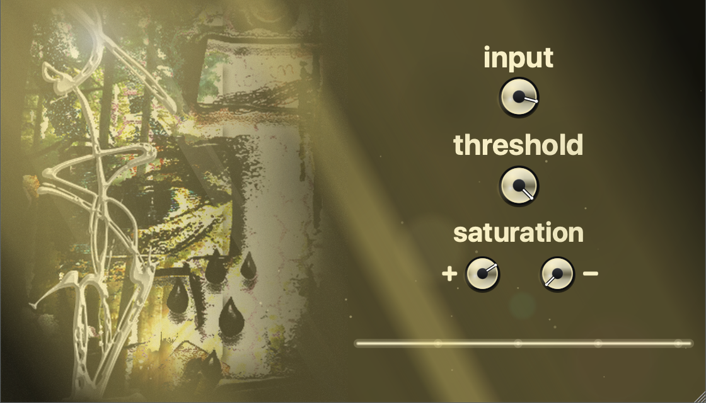
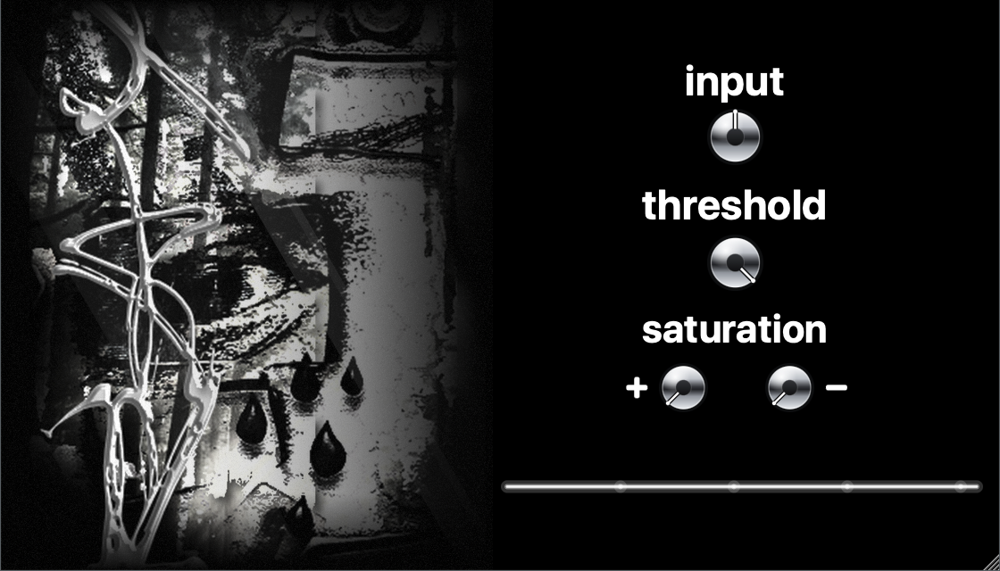
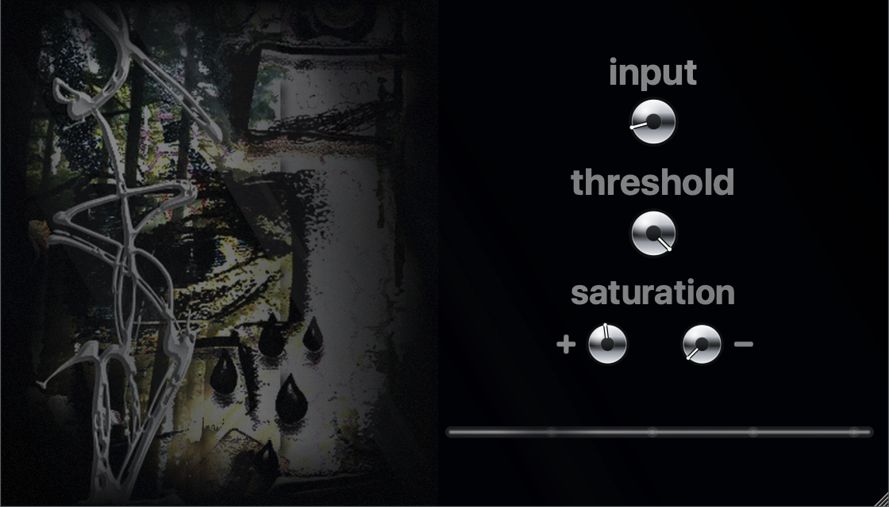

# RayClipper

A master-bus **soft clipper** audio plugin (VST3 / AU) by **fabiyoo**, built with [JUCE](https://juce.com).
8× oversampled clipping with an asymmetric tanh saturation stage and a living, light-reactive UI.



The interface is a window onto an outdoor scene, and driving the controls changes the weather:
the knobs are polished chrome that the sunlight bounces off, the labels and waveform catch the
light, and god-rays, drifting dust and lens flares build as you push the input.

| Idle | Shadow |
|------|--------|
|  |  |

## Controls

| Knob | Range | Audio | Visual |
|------|-------|-------|--------|
| **Input** | −9…+9 dB | drive into the clipper | centre = calm; up = sun, rays, flares; down = shadow |
| **Threshold** | −10…0 dB | clip ceiling | amount of bloom / glow |
| **Saturation +** | 0.1…2.0 | positive-half saturation | colour saturation of the scene |
| **Saturation −** | 0.1…2.0 | negative-half saturation | hue of the scene |

Signal chain: input gain → 8× oversample (half-band FIR) → per-sample tanh saturation
→ threshold soft-clip → downsample → hard clip at ±1. The visuals are purely cosmetic and
never touch the audio path.

## Install

Grab the latest zip for your OS from the [Releases](../../releases/latest) page, unzip it,
then copy the plugin into your system folder and rescan in your DAW.

### macOS

- **VST3** → `~/Library/Audio/Plug-Ins/VST3/`
- **AU** → `~/Library/Audio/Plug-Ins/Components/`

```sh
# from the unzipped folder
cp -R RayClipper.vst3 ~/Library/Audio/Plug-Ins/VST3/
cp -R RayClipper.component ~/Library/Audio/Plug-Ins/Components/   # optional, AU
```

The build is unsigned, so the first time macOS may block it. If Gatekeeper complains,
remove the quarantine flag:

```sh
xattr -dr com.apple.quarantine ~/Library/Audio/Plug-Ins/VST3/RayClipper.vst3
```

Then restart your DAW (or rescan plugins). In **FL Studio**: Options → Manage Plugins →
**Find more plugins**, then enable RayClipper. To update, quit FL, replace the `.vst3`
with the new one, and rescan.

### Windows

Copy `RayClipper.vst3` into the shared VST3 folder:

```
C:\Program Files\Common Files\VST3\
```

Then rescan plugins in your DAW. The Standalone `RayClipper.exe` in the zip runs on its own,
no DAW required.

## Build

Requires: CMake ≥ 3.22, a C++17 compiler (Xcode Command Line Tools on macOS).

```sh
# 1. get JUCE (not vendored in this repo)
git clone --depth 1 --branch 8.0.6 https://github.com/juce-framework/JUCE.git JUCE

# 2. configure + build
cmake -B build -DCMAKE_BUILD_TYPE=Release
cmake --build build --config Release
```

Builds VST3, AU, and a Standalone app into `build/ray_artefacts/Release/`.
On macOS they are also copied to `~/Library/Audio/Plug-Ins/`.

Prebuilt macOS and Windows binaries are attached to each tagged [release](../../releases).

## License

[MIT](LICENSE). JUCE has its own license — see the JUCE repository.
