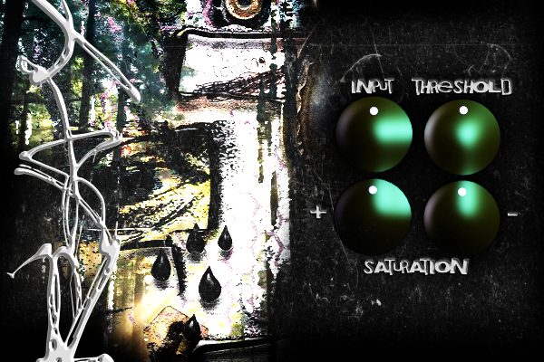

# RayClipper

A master-bus **soft clipper** audio plugin (VST3 / AU) by **fabiyoo**, built with [JUCE](https://juce.com).
8× oversampled clipping with an asymmetric tanh saturation stage and a custom UI.



## Controls

| Knob | Range | Does |
|------|-------|------|
| **Input** | −9…+9 dB | drive into the clipper |
| **Threshold** | −10…0 dB | clip ceiling |
| **Saturation +** | 0.1…2.0 | positive-half saturation amount |
| **Saturation −** | 0.1…2.0 | negative-half saturation amount |

Signal chain: input gain → 8× oversample (half-band FIR) → per-sample tanh saturation
→ threshold soft-clip → downsample → hard clip at ±1.

## Build

Requires: CMake ≥ 3.22, a C++17 compiler (Xcode Command Line Tools on macOS).

```sh
# 1. get JUCE (not vendored in this repo)
git clone --depth 1 --branch 8.0.6 https://github.com/juce-framework/JUCE.git JUCE

# 2. configure + build
cmake -B build -DCMAKE_BUILD_TYPE=Release
cmake --build build --config Release
```

Builds VST3, AU, and a Standalone app into `build/ray_artefacts/Release/`.
On macOS they are also copied to `~/Library/Audio/Plug-Ins/`.

## License

[MIT](LICENSE). JUCE has its own license — see the JUCE repository.
